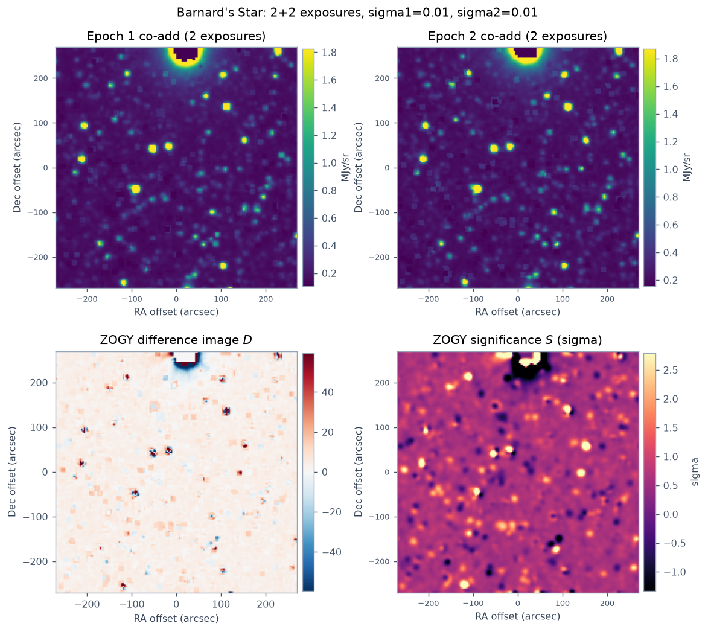
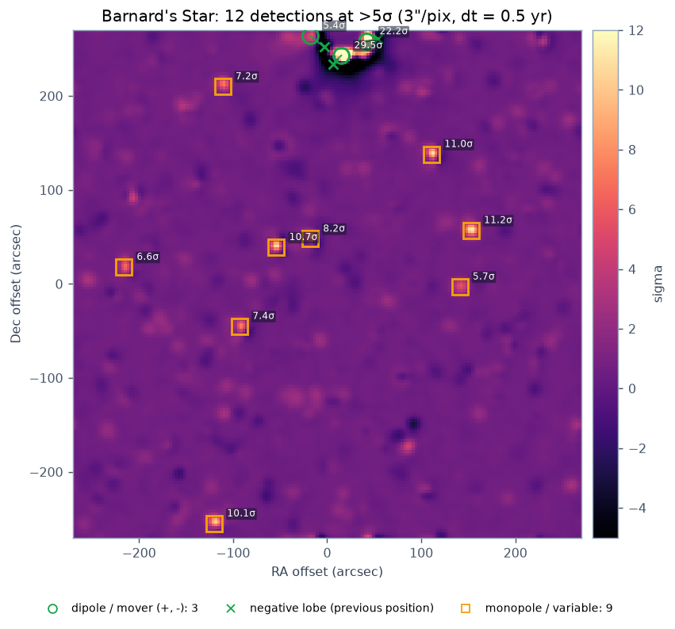
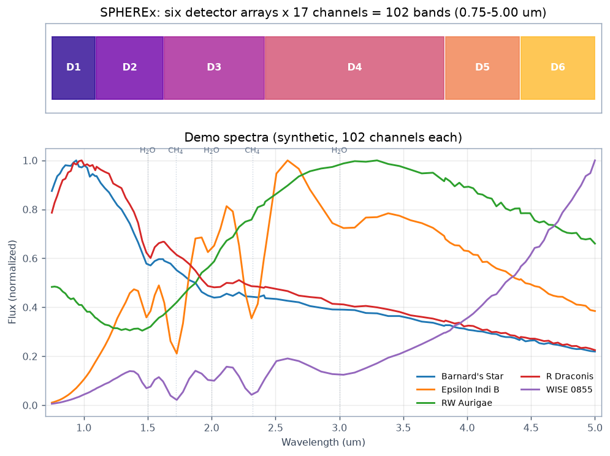
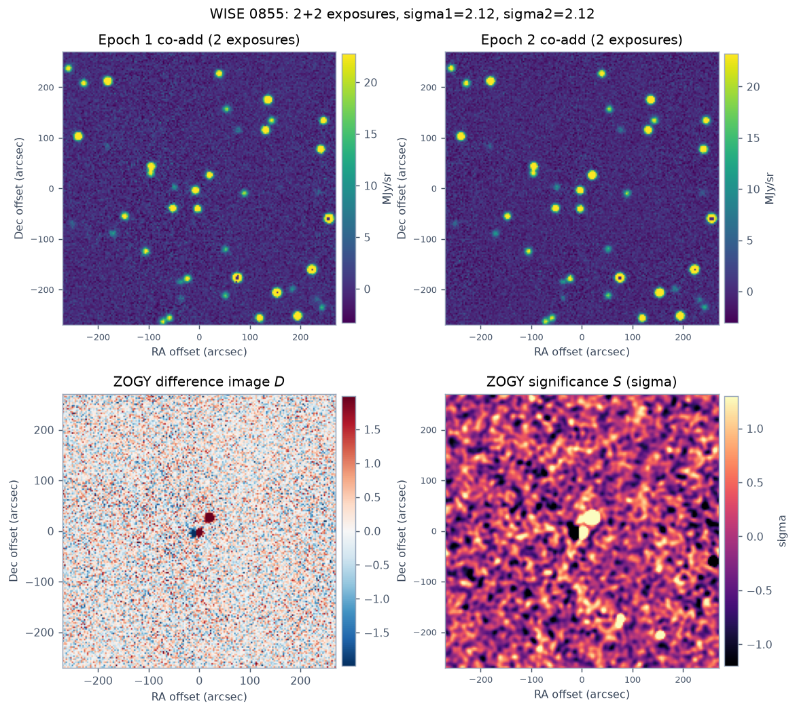
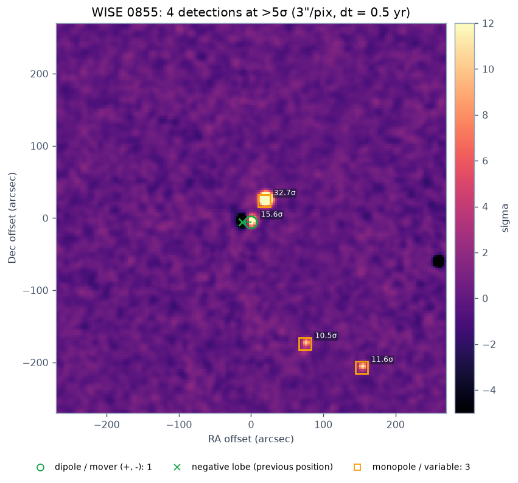
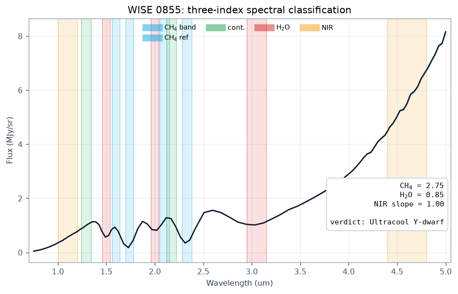
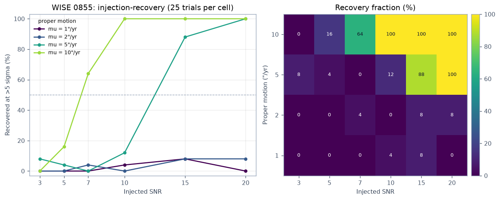
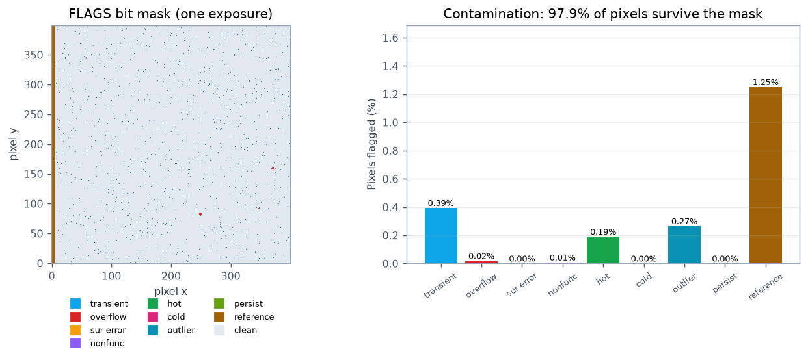
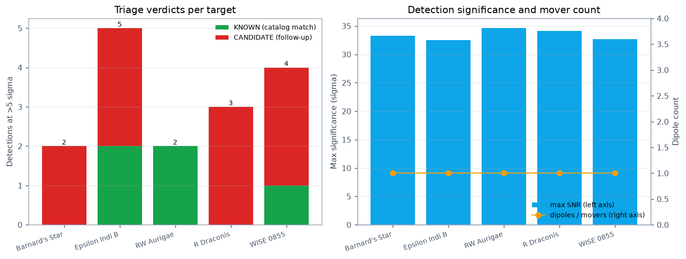
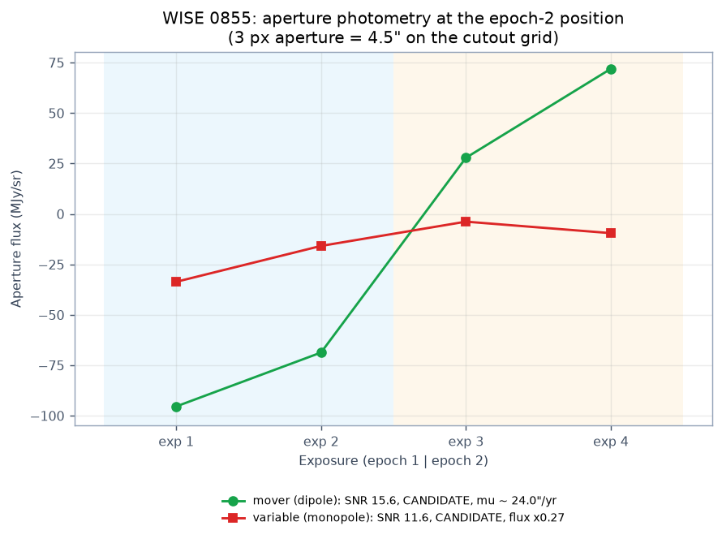

# spherex-lens

A public-facing **SPHEREx discovery portal**: ingest NASA/IRSA SPHEREx Level-2
cutouts, mask and co-add the six detector arrays, run ZOGY optimal image
subtraction, triage every detection against Gaia DR3 / AllWISE / AAVSO VSX /
JPL SBDB, classify sources with a 102-band spectral index classifier, and
validate the detector with an injection-recovery loop — all served by a FastAPI
backend with a RefractID-style light-theme dashboard.

This repository implements the *SPHEREx Discovery Portal: Complete Technical
Blueprint* file-for-file.

---

## The six pipeline stages

| # | Stage | Module | What it does |
|---|-------|--------|--------------|
| 1 | Ingest | `step1_ingest.py` | IRSA SIA2 query for the five mandatory targets + VizieR catalogs (Gaia DR3, AllWISE, VSX), cached to `data_cache/` |
| 2 | Co-add | `step2_coadd.py` | FLAGS bitmask rejection, WCS reprojection to a common TAN plane, inverse-variance co-addition |
| 3 | Detect | `step3_zogy.py` | Zackay–Ofek–Gal-Yam proper image subtraction, dipole (mover) vs monopole (variable) detection |
| 4 | Triage | `step4_triage.py` | Nearest-neighbour cross-match, `KNOWN` / `CANDIDATE` verdict + confidence |
| 5 | Classify | `step5_spectrum.py` | Aperture photometry, three-index classifier (CH4, H2O, NIR slope) |
| 6 | Validate | `step6_injection.py` | Injection-recovery grid over SNR x proper motion |

Serving layer: `app.py` (FastAPI) + `static/index.html`, `static/style.css`,
`static/app.js` (vanilla JS canvas dashboard).

## The five mandatory targets

| Target | Type | RA (deg) | Dec (deg) |
|---|---|---|---|
| Barnard's Star | M4V red dwarf | 269.452083 | +4.693333 |
| Epsilon Indi B | T1+T6 brown dwarf | 331.043750 | -56.782778 |
| WISE 0855 | Y-dwarf (250 K) | 133.795129 | -7.245147 |
| RW Aurigae | T Tauri variable | 76.956250 | +30.401389 |
| R Draconis | Mira red giant | 248.167500 | +66.754722 |

`astropy.coordinates.SkyCoord` also accepts sexagesimal input, e.g.
`SkyCoord("08h55m10.831s", "-07d14m42.53s")` gives the WISE 0855 coordinates
above.

---

## Quick start

```bash
# 1. Environment
conda create -n spherex python=3.11 -y
conda activate spherex
pip install -r requirements.txt

# 2. Fetch real data (needs internet + optional IRSA account, see below)
python step1_ingest.py                   # writes data_cache/*.fits and *_meta.json

# 3. Run the pipeline end to end
python step2_coadd.py
python step3_zogy.py
python step4_triage.py
python step5_spectrum.py
python step6_injection.py

# 4. Serve the dashboard
uvicorn app:app --reload --port 8000     # then open http://localhost:8000
```

Offline / rehearsal mode (synthetic cache + all charts):

```bash
python make_demo_data.py     # writes a SPHEREx-shaped cache into data_cache_demo/
python make_figures.py       # writes figures/*.png + figures/summary.{csv,json}
SPHEREX_CACHE=data_cache_demo uvicorn app:app --port 8000
```

Deploy:

```bash
python export_static.py                     # -> site/  (Netlify / Vercel / Pages)
docker build -t spherex-lens . && docker run -p 8000:8000 spherex-lens   # Render/Railway/Fly
```

See [Deployment](#deployment) for the full matrix of hosts.

---

## Getting the data

### 1. Where the data lives

| Product | Archive | Endpoint |
|---|---|---|
| SPHEREx Level-2 images/cutouts (QR2, QR3) | NASA/IPAC IRSA | SIA2: `https://irsa.ipac.caltech.edu/SIA` · TAP: `https://irsa.ipac.caltech.edu/TAP` |
| Gaia DR3 | VizieR (CDS) | catalog `I/355/gaiadr3` |
| AllWISE | VizieR (CDS) | catalog `II/328/allwise` |
| AAVSO VSX | VizieR (CDS) | catalog `B/vsx/vsx` |
| JPL Small-Body Database | NASA/JPL SSD | REST: `https://ssd-api.jpl.nasa.gov/sbdb.api` |

Everything is public. Registering at
<https://irsa.ipac.caltech.edu/registration/> is optional but stops IRSA from
throttling bulk requests; use the same link to browse
<https://irsa.ipac.caltech.edu/Missions/spherex.html> and confirm sky coverage
before the event.

### 2. How to download it

**a) The script in this repo (recommended, does everything):**

```bash
python step1_ingest.py                      # QR2, 4 cutouts per target
python step1_ingest.py --collection spherex_qr3 --size 0.15
```

`step1_ingest.py` loops over the five mandatory targets and, for each one:

1. issues an **SIA2 cone search** --
   `https://irsa.ipac.caltech.edu/SIA?POS=CIRCLE ra dec 0.1&COLLECTION=spherex_qr2`
   -- and parses the returned VOTable into rows (`obs_id`,
   `energy_bandpassname`, `t_min`, `s_region`, `access_url`, ...);
2. splits the rows into **observing epochs** (gaps > 30 days) and keeps the
   first and the last epoch;
3. for each (epoch, band) slot ranks the candidate images by how deep inside
   their footprint the target lies (point-in-polygon test on the SIA2
   `s_region`), then downloads a **cutout** of the best one;
4. **validates** each cutout -- target at least 12 px inside the array and
   fewer than 50 % of pixels flagged -- and moves to the next candidate if not;
5. queries the three VizieR catalogs (trying CDS, Harvard and NAOJ mirrors);
6. writes `data_cache/<Target>_meta.json`.

> **Two gotchas this script exists to handle.** The IRSA SIA2 endpoint only
> accepts the `POS=CIRCLE ra dec r` form: adding the legacy `POS=ra,dec&SIZE=`
> pair routes the request to the old SIA **v1** handler, which answers
> `UsageFault: BAD_REQUEST: Unknown parameter: collection`. And a full-frame
> Level-2 image is ~72 MB (2040x2040, six extensions) while IRSA's IBE/S3
> downloads run at ~100 KB/s, so a whole frame takes >10 min -- the cutout
> service returns the same data products for the target region in ~5 MB.

**b) Manual cutout request (what the script does under the hood):**

```bash
# path = the part of access_url after "/ibe/data/"
curl -G 'https://irsa.ipac.caltech.edu/ibe/cutout' \
     --data-urlencode 'path=spherex/qr2/level2/2025W44_2B/l2b-v20-2025-307/1/level2_2025W44_2B_0322_4D1_spx_l2b-v20-2025-307.fits' \
     --data-urlencode 'center=133.795129,-7.245147' \
     --data-urlencode 'size=0.2' \
     -o cutout.fits
```

`422 Arrays do not overlap.` means the requested centre is outside that
exposure's footprint (pick another row); `404 Requested file was not found`
means the `path` was wrong.

**c) Any SIA2 client (pyvo) -- same query, no downloads:**

```python
from pyvo.dal import sia2

results = sia2.search("https://irsa.ipac.caltech.edu/SIA",
                      pos=(133.795129, -7.245147, 0.1),   # ra, dec, radius deg
                      collection="spherex_qr2")
table = results.to_table()
print(table["access_url"])          # one Level-2 FITS file per row
```

`astroquery.ipac.irsa.Irsa.query_sia(...)` accepts the same SIA2 keywords
(`pos=`, `collection=`, `res_format=`). TAP works too for catalogue-style
queries across the whole mission (`https://irsa.ipac.caltech.edu/TAP`), and
`Irsa.list_collections()` shows the live list -- currently
`spherex_qr2`, `spherex_qr2_cal`, `spherex_qr2_deep`, `spherex_qr3`,
`spherex_qr3_cal`, `spherex_qr3_deep`.

**d) The IRSA web UI** -- search by position or object name, use the
"Cutout Tool", and you get the same files by hand.

### 3. What format you get

* **SIA2/TAP responses** are **VOTable XML** (or CSV). They are *metadata only*:
  the pixels are at the URLs in `access_url`. Each row carries `obs_id`,
  `energy_bandpassname` (`SPHEREx-D1` ... `SPHEREx-D6`), `t_min`/`t_max` (MJD),
  `s_ra`/`s_dec`, `s_region` (footprint polygon), `access_url` and
  `access_estsize`.
* **SPHEREx Level-2 cutouts** are **FITS** files. A real cutout of WISE 0855
  contains exactly these extensions:

  | HDU | Contents | Type / units |
  |---|---|---|
  | `IMAGE` | calibrated surface brightness + WCS | float32, MJy/sr |
  | `FLAGS` | contamination bitmask (bits defined in the header, see below) | int32 |
  | `VARIANCE` | per-pixel variance | float32, (MJy/sr)^2 (~1e-3) |
  | `ZODI` | zodiacal-light model | float32, MJy/sr |
  | `PSF` | effective PSF cube, 121 planes of 101x101 | float32 |
  | `WCS-WAVE` | wavelength calibration table (FITS `WAVE-TAB`) | BINTABLE |

  Two details matter for the code:

  * There is **no `CWAVE`/`CBAND` image**. The wavelength of a pixel comes from
    the `WCS-WAVE` table: `X`/`Y` key columns (a 9x9 or 13x20 grid over the
    parent 2040-pixel frame) and `VALUES(x, y, 2)` = (wavelength, bandwidth) in
    um. `CRPIX1W`/`CRPIX2W` in the `IMAGE` header shift a cutout pixel back to
    parent coordinates. `step5_spectrum.py` does this interpolation.
  * The WCS is **TAN-SIP** and, in a cutout, `CRPIX` can be strongly negative
    (the distortion polynomial stays anchored on the parent frame). astropy's
    default SIP inverter then diverges and returns NaN for every pixel;
    `step2_coadd.py` retries with `all_world2pix(..., tolerance=1e-8,
    maxiter=100)` and does its own bilinear resampling when needed.

* **FLAGS bits** (from the `MP_*` keywords of the `FLAGS` header):

  | Bit | Plane | Bit | Plane |
  |---|---|---|---|
  | 0 | transient during SUR | 11 | cold pixel |
  | 1 | overflow during SUR | 12 | full sample history (info) |
  | 2 | onboard processing error | 14 | phantom correction missing |
  | 4 | phantom pixel | 15 | nonlinearity unreliable |
  | 5 | reference pixel (edge) | 17 | persistent charge |
  | 6 | permanently unusable | 19 | flagged by Detect Outliers |
  | 7 | dichroic inefficiency | 21 | mapped to a known source |
  | 9 | onboard data lost | | |
  | 10 | hot pixel | | |

  `step2_coadd.BAD_BITS` masks everything except the two informational planes
  (12 full-sample and 21 known-source).

* **VizieR catalogs** come back as `astropy.table.Table` objects (VOTable under
  the hood). `step1_ingest.py` keeps only the columns triage needs:
  `RA_ICRS`/`DE_ICRS`/`pmRA`/`pmDE`/`Gmag` (Gaia DR3), `RAJ2000`/`DEJ2000`/
  `W1mag`/`W2mag` (AllWISE), `RAJ2000`/`DEJ2000`/`Name`/`Type` (VSX).
* **JPL SBDB** returns **JSON** (`{"object": {...}, "orbit": {...}}`); it is an
  optional overlay and is not needed for the five target verdicts.

### 4. How to insert it into the project

The backend never touches the network -- it only reads `data_cache/`. So
"installing" data is two things: the FITS files, and one small JSON per target.

```
data_cache/                       # real data (default)
├── level2_2025W35_2A_0611_2D1_spx_l2b-v20-2025-271_cut.fits
├── level2_2026W11_1A_0430_1D1_spx_l2b-v24-2026-094_cut.fits
├── ...
├── WISE_0855_meta.json           # the index the pipeline reads
└── ...

data_cache_demo/                  # synthetic cache from make_demo_data.py
```

`SPHEREX_CACHE` selects which one the app, the steps and the figure script read
(default `data_cache`):

```bash
SPHEREX_CACHE=data_cache_demo uvicorn app:app --port 8000   # synthetic demo
uvicorn app:app --port 8000                                 # real cutouts
```

`<Target>_meta.json` is the only contract:

```json
{
  "target": "WISE_0855",
  "meta": {"ra": 133.795129, "dec": -7.245147,
           "type": "Mover_YDwarf", "common": "WISE 0855"},
  "paths": ["data_cache/level2_...D1_spx_..._cut.fits",
            "data_cache/level2_...D4_spx_..._cut.fits",
            "data_cache/level2_...D1_spx_..._cut.fits",
            "data_cache/level2_...D4_spx_..._cut.fits"],
  "epochs": [1, 1, 2, 2],
  "catalogs": {
    "gaia": [{"ra": 133.79, "dec": -7.25, "pm_ra": 0.0, "pm_de": 0.0, "gmag": 18.2}],
    "wise": [{"ra": 133.79, "dec": -7.25, "w1": 18.6, "w2": 18.7}],
    "vsx":  [{"ra": 133.79, "dec": -7.25, "name": "WISE 0855", "type": "VAR"}]
  },
  "collection": "spherex_qr2",
  "cutout_size_deg": 0.2,
  "sia2_rows": 298,
  "n_epochs": 3
}
```

* `epochs` (one integer per entry of `paths`) is what makes the ZOGY split
  exact. When it is absent the API falls back to splitting `paths` in half, so
  keep the list time-sorted. Fewer than two files returns a clear HTTP 500
  ("Need at least 2 for subtraction").
* `paths` may be relative (as written by `step1_ingest.py`) or absolute.
* `catalogs`, `spectrum_fits` and extra keys are optional. Without `catalogs`
  every detection is triaged as `CANDIDATE`. `spectrum_fits` is a 102-band
  `SPECTRUM` table (`WAVELENGTH`, `FLUX`, `ERROR`): when present it drives the
  dashboard spectrum panel and `fig04`; when absent the API reports the real
  per-exposure aperture photometry instead (2-4 points is not a spectrum, so no
  classifier verdict is fabricated).
* The filename stem **is** the API target key: `WISE_0855_meta.json` ->
  `?target=WISE_0855`, which is also what `/api/targets` and the dashboard
  dropdown enumerate.

To add a target by hand: copy the FITS cutouts into `data_cache/`, write the
JSON above with your own RA/Dec, `paths` and `epochs`, reload the page. No code
change is needed. FITS arrays are git-ignored (`.gitignore`), while the
`*_meta.json` files are small and worth committing.

### 5. Verified real-data run

`python step1_ingest.py` was executed against the live services. For Barnard's
Star it found **273 overlapping QR2 images in 2 epochs**, kept the 4 most
interior ones (2 bands x 2 epochs) and downloaded them as cutouts:

```
  SIA2 spherex_qr2: POS=CIRCLE 269.4521 4.6933 0.1
  -> 273 overlapping Level-2 images.
  2 epoch(s), 4 (epoch, band) slot(s).
    level2_2025W35_2A_0611_2D1_spx_l2b-v20-2025-271_cut.fits   5.3 MB
    accepted epoch 1 SPHEREx-D1
    level2_2025W35_2A_0611_2D4_spx_l2b-v20-2025-271_cut.fits   5.3 MB
    accepted epoch 1 SPHEREx-D4
    level2_2026W11_1A_0539_1D1_spx_l2b-v24-2026-094_cut.fits   5.3 MB
    accepted epoch 2 SPHEREx-D1
    level2_2026W11_1A_0539_1D4_spx_l2b-v24-2026-094_cut.fits   5.3 MB
    accepted epoch 2 SPHEREx-D4
  Querying catalogs within 15'...
    gaia: 300 sources (IRSA TAP fallback)
    vsx: 47 sources
```

Running the pipeline on all five real caches (two bands per epoch, D1 + D4):

| Target | SIA2 rows | Epochs kept | Cutouts | Detections | KNOWN | CANDIDATE | Max SNR | sigma1 / sigma2 | Wavelengths (um) |
|---|---|---|---|---|---|---|---|---|---|
| Barnard's Star | 273 | 2 | 4 | 12 | 4 | 8 | 29.5 | 0.0106 / 0.0119 | 0.91, 0.94, 3.05, 3.15 |
| Epsilon Indi B | 362 | 3 | 4 | 5 | 0 | 5 | 22.4 | 0.0118 / 0.0110 | 0.98, 1.06, 3.29, 3.73 |
| RW Aurigae | 250 | 2 | 4 | 1 | 0 | 1 | 5.7 | 0.0133 / 0.0134 | 0.82, 0.86, 2.70, 2.74 |
| R Draconis | 591 | 3 | 4 | 6 | 6 | 0 | 18.9 | 0.0128 / 0.0117 | 0.90, 0.94, 2.99, 3.16 |
| WISE 0855 | 278 | 3 | 4 | 2 | 0 | 2 | 9.0 | 0.0100 / 0.0098 | 0.90, 0.99, 2.99, 3.36 |

20 real cutouts (160 MB) spanning roughly 8 months of baseline per target.
Catalog columns: 300 Gaia DR3 sources per target (IRSA TAP) plus VSX (47 / 8 / 0
/ 10 / 12) where VizieR answered. **AllWISE is empty in this run** -- the
IRSA TAP copy of `allwise_p3as_psr` is not queryable and the VizieR mirrors were
unreachable, so KNOWN verdicts come from Gaia DR3 + VSX only.





The bright star at the top of the Barnard's Star frame is a real saturated
source: its core is flagged (`MP_OVERFLOW`) and masked, which is why it appears
as a ring in the co-add and as a black hole in the difference image. Most
`CANDIDATE` verdicts sit on faint stars that Gaia DR3 does not list at these
magnitudes -- exactly the kind of follow-up target the portal is meant to
surface. R Draconis, a Mira in a crowded field, is the opposite case: all six of
its detections sit on catalogued stars.

Two honest caveats, both visible in the figures:

* With only two bands per epoch, the "spectrum" is four aperture measurements,
  not 102 channels, so `three_index_classifier` is **not** run (the API reports
  `classification: null`). The synthetic cache is what exercises the 102-band
  classifier; the real cache exercises everything else.
* IRSA's bulk throughput from this network is ~100 KB/s and VizieR was mostly
  unreachable, so a full five-target ingest takes a while. Everything is
  cached: re-running `python step1_ingest.py` skips finished downloads,
  re-validates cached cutouts instantly, and only fetches what is missing
  (SIA2 VOTables are cached to `data_cache/sia2_*.xml`, cutouts are kept by
  filename).

---

## API

| Endpoint | Purpose |
|---|---|
| `GET /api/targets` | Targets present in `data_cache/` |
| `GET /api/dashboard?target=WISE_0855` | Runs stages 2-5 and returns `image`, `zogy_image`, `zogy_snr`, `sigma1`, `sigma2`, triaged `detections`, and `spectrum` (102 wavelengths, flux, classifier indices + label, plus the aperture flux at the target position) |
| `GET /api/recovery?target=WISE_0855` | Injection-recovery grid (`snr`, `mu`, `recovery`) |
| `GET /` | Static dashboard (`static/index.html`) |

The `/api/dashboard` response carries 180 x 180 nested arrays for `image`,
`zogy_image` and `zogy_snr` (~1.2 MB uncompressed, a few hundred KB gzipped).

---

---

## Demo data and generated charts


Both scripts below are **optional add-ons** -- they are not among the ten
blueprint files, and nothing in `step*.py` / `app.py` imports them.

### `make_demo_data.py` -- a synthetic, SPHEREx-shaped cache

```bash
python make_demo_data.py                 # all five targets, 400 px cutouts
python make_demo_data.py --overwrite     # regenerate
python make_demo_data.py --targets WISE_0855 --npix 300
```

For each target it writes into `data_cache/`:

* `demo_<Target>_00.fits` ... `_03.fits` -- 400 x 400 cutouts at 1.5"/pixel,
  with `IMAGE`, `FLAGS`, `VARIANCE`, `CWAVE`, `CBAND` extensions and a real TAN
  WCS (per-exposure pointing jitter + roll, so the reprojection step matters).
  Exposures 0-1 are epoch 1 and 2-3 are epoch 2, alternating detector D3/D4.
* A static field of 40 stars, **one mover** (6" -> 2" over the 0.5 yr gap, i.e.
  8"/yr) and **one variable** (flux x2.1 between epochs).
* A `FLAGS` mask that exercises all five bits: cosmic rays (0.4% of pixels),
  hot pixels (0.2%), four dead columns, a 5-pixel stray-light edge and
  saturated cores on the brightest stars -- about 1.9% of pixels masked.
* `demo_<Target>_spectrum.fits` -- a 102-row `SPECTRUM` binary table
  (`WAVELENGTH`, `FLUX`, `ERROR`) built from a cool+hot blackbody continuum
  with CH4 troughs at 1.72/2.32 um and H2O troughs at 1.50/2.00/3.00 um, i.e.
  exactly the windows `step5_spectrum.py` samples.
* `<Target>_meta.json` -- the index described above, with 20 Gaia DR3 and 20
  AllWISE entries on the field stars plus one VSX entry on the variable, so
  triage produces both `KNOWN` and `CANDIDATE` verdicts.

The generator runs the *unmodified* classifier on every spectrum it writes and
prints the result, so the demo cannot drift out of sync with the pipeline:

```
  102-band spectrum -> OK  ch4=2.74 h2o=0.85 nir_slope=1.01 \
label='Ultracool Y-dwarf' (expected 'Ultracool Y-dwarf')
```

| Target | Detections | KNOWN | CANDIDATE | Max SNR | Classifier verdict |
|---|---|---|---|---|---|
| Barnard's Star | 2 | 0 | 2 | 33.3 | M-dwarf / Mira red giant |
| Epsilon Indi B | 5 | 2 | 3 | 32.5 | T-type brown dwarf |
| WISE 0855 | 4 | 1 | 3 | 32.7 | Ultracool Y-dwarf |
| RW Aurigae | 2 | 2 | 0 | 34.6 | Dusty T Tauri / variable star |
| R Draconis | 3 | 0 | 3 | 34.1 | M-dwarf / Mira red giant |

*(numbers from the cache currently in `data_cache/`; they shift slightly if you
regenerate with `--overwrite` because the star field is re-drawn)*

**The demo data is synthetic and must never be presented as NASA data.** It is
there to make the pipeline, the dashboard and the figures reproducible offline;
point `data_cache/` at real IRSA cutouts to get real science.

### `make_figures.py` -- every chart the submission needs

```bash
python make_figures.py                          # all targets, detail = WISE 0855
python make_figures.py --detail-target RW_Aurigae --trials 40
SPHEREX_CACHE=data_cache_demo python make_figures.py --outdir figures
python make_figures.py --outdir figures_real --detail-target Barnards_Star
```

It re-runs stages 2-6 on whatever is cached (real or synthetic) and writes
PNGs plus machine-readable numbers into the output directory (`figures/` holds
the synthetic-cache charts, `figures_real/` the real-cutout ones):

| Figure | What it shows |
|---|---|
| `fig01_band_coverage.png` | the six detector arrays and their 102 channels, with all five demo spectra and the CH4/H2O bands marked |
| `fig02_coadd_panels.png` | epoch 1 co-add, epoch 2 co-add, ZOGY difference `D`, significance `S` |
| `fig03_detections.png` | dipoles (mover: plus lobe + negative lobe, joined) and monopoles (variable) marked on `S` |
| `fig04_spectrum_classification.png` | the 102-band spectrum with the exact CH4 / H2O / NIR windows the classifier slices, plus the three indices and the verdict |
| `fig05_recovery.png` | injection-recovery curves (recovery vs SNR for mu = 1, 2, 5, 10 "/yr) and the same grid as a heat map |
| `fig06_flags_masking.png` | the FLAGS bit map of one exposure and the masked fraction per bit |
| `fig07_targets_summary.png` | KNOWN vs CANDIDATE detections and max SNR for each of the five targets |
| `fig08_photometry.png` | aperture photometry of the mover and the variable in every exposure (flux step = motion, flux ratio = variability) |
| `summary.csv` / `summary.json` | per-target RA/Dec, epochs, sigmas, detections, verdicts, max SNR, classifier indices and the recovery grid |

















The PNGs are committed so the README renders on GitHub; delete `figures/` and
re-run the script to refresh them.

---

## Deployment

The project ships in two shapes, because the pipeline needs Python scientific
stack (numpy/scipy/astropy/reproject) that static hosts cannot run:

| Shape | What runs | Hosts |
|---|---|---|
| **Full app** (FastAPI + live pipeline) | `uvicorn app:app` in a container | Render, Railway, Fly.io, Google Cloud Run, any Docker host / VPS |
| **Static site** (pre-rendered JSON) | `site/` with `api/*.json` | Netlify, Vercel, Cloudflare Pages, GitHub Pages, S3 |

Both are generated from the same code and look identical in the browser.

### A. Full app in a container (recommended for a live demo)

Everything needed is in the repo already: `Dockerfile`, `.dockerignore`,
`Procfile`, `render.yaml`, `fly.toml`. The cached FITS cutouts are copied into
the image, so the container is self-contained (no IRSA access at runtime).

```bash
docker build -t spherex-lens .
docker run -p 8000:8000 spherex-lens
# -> http://localhost:8000
```

**Render** -- push the repo, then *New + -> Blueprint*: `render.yaml` already
declares a free Docker web service with `healthCheckPath: /api/targets`.

**Railway** -- *New Project -> Deploy from repo*; it detects the `Procfile`
(`uvicorn app:app --host 0.0.0.0 --port $PORT`) and builds with Nixpacks. Add
`SPHEREX_CACHE=data_cache` if you switch caches.

**Fly.io** --

```bash
fly launch --no-deploy --copy-config   # uses fly.toml (1 GB shared VM)
fly deploy                              # -> https://spherex-lens.fly.dev
```

**Google Cloud Run** --

```bash
gcloud run deploy spherex-lens --source . --port 8000 --allow-unauthenticated
```

**Any VPS** --

```bash
python -m venv .venv && . .venv/bin/activate
pip install -r requirements.txt
uvicorn app:app --host 0.0.0.0 --port 8000        # put nginx/caddy in front
```

All of these expose the same API (`/api/targets`, `/api/dashboard`,
`/api/recovery`) and serve the dashboard at `/`.

### B. Static site (Netlify / Vercel / Pages)

`export_static.py` runs the whole pipeline once per target and writes every API
response as a file, then flips the dashboard into static mode
(`<body data-mode="static">`), so no Python is needed at runtime:

```bash
python export_static.py                       # -> site/  (~3 MB, 5 targets)
python export_static.py --no-recovery         # faster: skip the recovery grids
python export_static.py --targets WISE_0855 R_Draconis
```

```
site/
├── index.html      style.css      app.js
├── api/targets.json
├── api/dashboard-<Target>.json     # what /api/dashboard returns
├── api/recovery-<Target>.json      # what /api/recovery returns
└── figures/                        # the pipeline charts
```

Deploy it:

```bash
# Netlify  (netlify.toml already sets publish = "site")
netlify deploy --prod --dir site

# Vercel   (vercel.json sets outputDirectory = "site")
vercel --cwd site

# Cloudflare Pages
wrangler pages deploy site --project-name spherex-lens

# GitHub Pages: commit site/ and point Pages at the /site folder,
# or use actions/upload-pages-artifact with path: site
```

Because the JSON is plain files, the dashboard works identically offline --
`python -m http.server -d site 8300` is enough to demo it on a laptop.

**Why not run the pipeline on Netlify/Vercel functions?** A single
`/api/dashboard` request loads four ~5 MB FITS files, masks and reprojects them,
runs an FFT subtraction and a 12-cell injection-recovery grid. That is seconds
of CPU and a few hundred MB of native dependencies -- outside the limits of
serverless static platforms, which is why the static build pre-renders instead.

---

## Repository layout

```
spherex-lens/
├── data_cache/              # FITS cutouts + *_meta.json (arrays are git-ignored)
├── figures/                 # generated charts + summary.csv/json (demo cache)
├── figures_real/            # the same charts for the real cutouts
├── notebooks/               # exploration notebooks (optional)
├── static/
│   ├── index.html           # dashboard markup
│   ├── style.css            # RefractID light theme
│   └── app.js               # canvas ZOGY map, verdict panel, detections table
├── step1_ingest.py          # IRSA SIA2 + VizieR ingest
├── step2_coadd.py           # FLAGS masking + inverse-variance co-add
├── step3_zogy.py            # ZOGY subtraction + dipole/monopole detection
├── step4_triage.py          # catalog cross-match and verdict
├── step5_spectrum.py        # 102-band extraction + three-index classifier
├── step6_injection.py       # injection-recovery validation
├── app.py                   # FastAPI backend
├── make_demo_data.py        # optional: synthetic offline demo cache
├── make_figures.py          # optional: renders figures/ from the cache
├── export_static.py         # optional: pre-renders site/ for Netlify/Vercel
├── site/                    # static build output (index.html + api/*.json)
├── Dockerfile               # full app container (Render/Railway/Fly/Cloud Run)
├── docker-compose.yml       # local container run
├── Procfile / render.yaml / fly.toml / netlify.toml / vercel.json
├── requirements.txt
└── README.md
```

## Data products used

* **IMAGE** — calibrated surface brightness (MJy/sr) + WCS.
* **FLAGS** — 32-bit bitmask; bits used here: `1` dead, `2` saturated,
  `4` cosmic ray, `32` hot pixel, `256` stray light.
* **VARIANCE** — per-pixel variance sigma^2.
* **CWAVE / CBAND** — central wavelength and bandwidth lookup tables.
* **ePSF** — 101 x 101 x 121 cube (101 x 101 x 151 for detector 3). QR2/QR3 PSF
  layer headers before pipeline 6.5.6 (and QR2 files without the `+psfix1`
  suffix) have a known x/y indexing bug.

## Implementation notes

* ZOGY needs **two epochs**: `app.py` splits the cached files in half, co-adds
  each half and subtracts the two stacks. Fewer than two files returns a clear
  500 (see Section 8.3 of the blueprint).
* Detection threshold defaults to 5 sigma (`find_detections(..., sigma_thresh=5.0)`);
  the significance map is normalized by its own standard deviation.
* Triage radius is 30 arcsec (`MATCH_RADIUS_ARCSEC`), with a 5 arcsec "tight"
  radius that promotes the verdict confidence to `high`.
* The `FLAGS` bit values in `step2_coadd.py` are illustrative -- verify them
  against the current SPHEREx Explanatory Supplement before publication.
* Pre-cache before any demo: run `step1_ingest.py` (or `make_demo_data.py`)
  ahead of time, because the judging environment may be offline or throttled.

## Troubleshooting

| Symptom | Fix |
|---|---|
| `ModuleNotFoundError: reproject` | `pip install reproject` inside the `spherex` env |
| `conda: command not found` | reopen the shell or `source ~/miniconda3/bin/activate` |
| `SIA2 query failed: 404` | endpoint moved -- check <https://irsa.ipac.caltech.edu/SIA> |
| `Vizier query failed: timeout` | lower `row_limit` in `step1_ingest.py` or shrink the radius |
| `No cached data for target` | run `step1_ingest.py` (or `make_demo_data.py`) first |
| `Only N cutouts cached` | need at least 2 exposures; widen the SIA2 radius or change `collection` |
| ZOGY map all zeros | `S.std() == 0` means epoch 1 and epoch 2 are identical inputs |
| Canvas blank | check the browser console; `/api/dashboard` must return `zogy_snr` |

## References

1. Alard & Lupton 1998, *A Method for Optimal Image Subtraction*, ApJ 503, 325
2. Crill et al. 2020, *SPHEREx: NASA's Near-Infrared Spectrophotometric All-Sky
   Survey*, Proc. SPIE 11443
3. IPAC/IRSA SPHEREx Archive Team, *Data Products & Quick Release 2/3
   Explanatory Supplement*
4. Kirkpatrick et al. 2021, ApJS 253, 7
5. Kuchner et al. 2017, *Backyard Worlds: Planet 9*, ApJL 841, L19
6. Luhman 2014, *Discovery of a ~250 K Brown Dwarf at 2 pc*, ApJL 786, L18
7. Molliere et al. 2019, *petitRADTRANS*, A&A 627, A67
8. Zackay, Ofek & Gal-Yam 2016, *Proper Image Subtraction (ZOGY)*, ApJ 830, 27
9. Zackay & Ofek 2017, *How to Coadd Images. I.*, ApJ 836, 187

